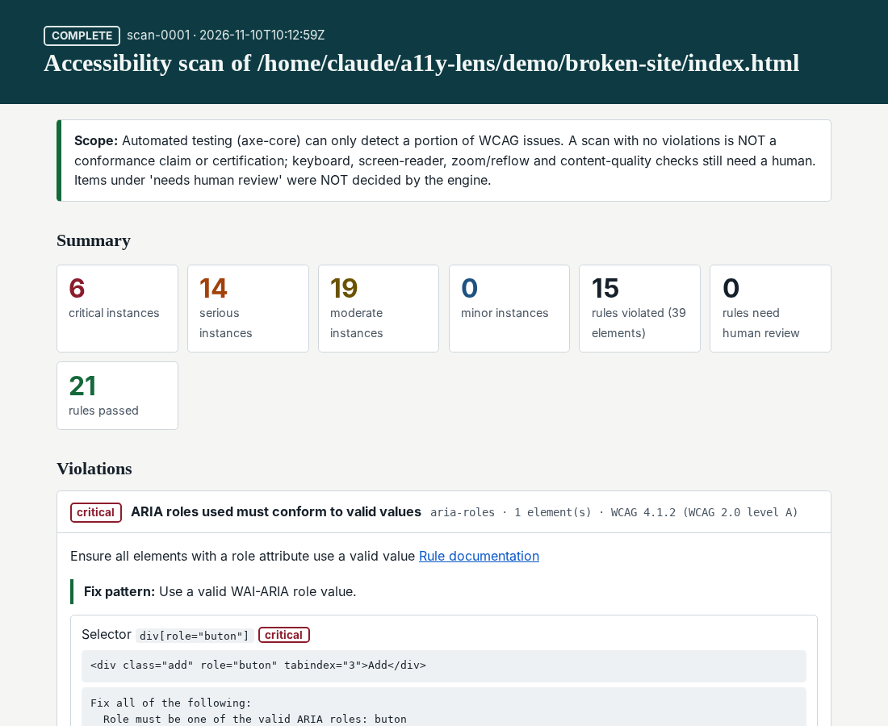
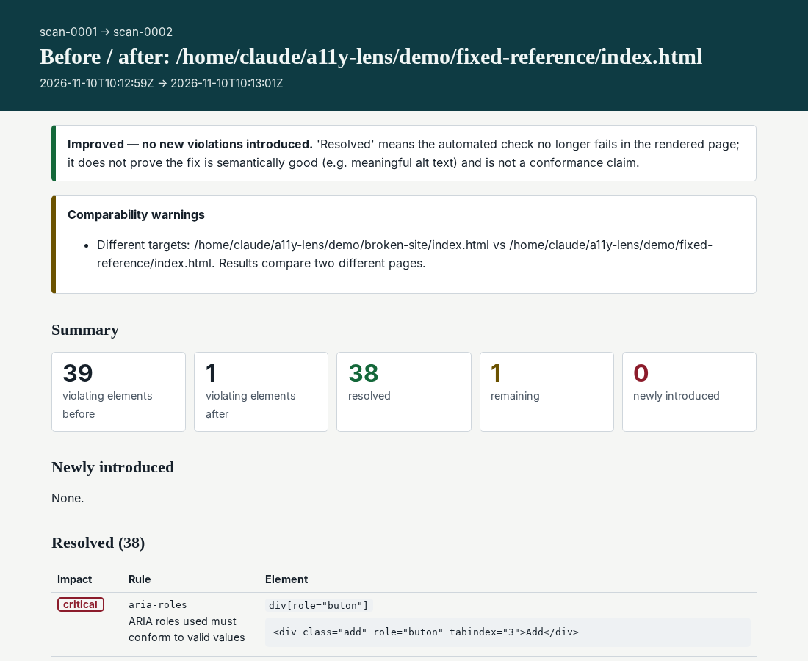

# A11Y Lens

**Hermes doesn't just claim it fixed your accessibility bugs. It re-opens the page in a real browser and proves it.**

A11Y Lens gives Hermes Agent the workflow of an accessibility test engineer:

1. **Scan** the *rendered* page in headless Chromium with the **axe-core** engine
2. **Evidence** for every finding (CSS selector, HTML, failure reason, measured contrast, screenshot)
3. **Repair** with Hermes' normal file/terminal tools (the plugin never edits your code)
4. **Re-scan** the same page
5. **Compare**: which violations were *resolved*, which *remain*, which were *newly introduced*

No model-invented violations, no hard-coded scores, no "WCAG compliant" claims. Every number in a report is axe-core output from an actual browser run.




*(Both images are real output from scanning the bundled demo site; live HTML in [`docs/sample/`](docs/sample/).)*

## Install (3 commands)

```bash
hermes plugins install Johnlocke0347/a11y-lens --enable
hermes a11y install     # one-time: downloads Playwright's Chromium (~150 MB, official Playwright CDN)
hermes a11y doctor      # real self-test: launches the browser, runs axe, must find a planted violation
```

Already have Chrome or Edge? Skip `hermes a11y install`; A11Y Lens falls back to system Chrome/Edge automatically.

## 90-second demo

```bash
hermes a11y demo                 # copies a deliberately inaccessible coffee-shop site to ./a11y-lens-demo
hermes
> Audit ./a11y-lens-demo with A11Y Lens, fix the issues in the source, rescan, and prove it improved.
```

Hermes runs `a11y_scan` (39 real violations on the bundled site), edits the HTML/CSS itself, runs `a11y_scan` again, then `a11y_compare` and reports exactly what changed, including anything it broke. Reset any time with `hermes a11y demo --reset`.

## Tools

| Tool | What it does |
|---|---|
| `a11y_scan(url, viewport?, timeout_s?, note?)` | Scans a localhost URL, or a local `.html` file / folder (served on a temporary loopback server). Returns `scan_id`, severity counts, top findings with selectors and fix patterns, and paths to the JSON + HTML reports. |
| `a11y_report(scan_id?, rule_id?, impact?, include?)` | Full stored evidence of a past scan (violations, *needs human review*, passed rules). No `scan_id` lists history. |
| `a11y_compare(before_id, after_id?)` | Resolved / remaining / **introduced** / severity-changed. `before_id="previous"` and `after_id="latest"` work. |

Also: a `/a11y` slash command, `hermes a11y …` CLI (`install`, `doctor`, `scan`, `scans`, `compare`, `allow`, `origins`, `demo`) and a bundled `a11y-repair` skill that teaches the scan → fix → rescan → compare loop.

## Why this isn't "a prompt in a trench coat"

- **Real browser, real DOM.** Playwright + Chromium, axe injected into every frame (iframes are audited; if one can't be, the scan is marked `incomplete`).
- **Honest status.** `complete`, `incomplete` or `failed`. A 404, timeout, crash, blocked redirect or partially audited page is *never* reported as a finished audit, and `a11y_compare` refuses to compare one.
- **Machine findings vs human review are separate.** axe's "incomplete" results (e.g. contrast over gradients) are listed as *needs human review* and never counted as violations or passes.
- **Regression detection that survives edits.** Elements are matched by rule + selector, then normalised HTML, then tag + text, each element at most once, so a fix that shifts selectors isn't misreported as "fixed one, broke one". Every "remaining" item says which pass matched it.
- **Persistent history** in SQLite via Hermes' plugin storage; reports are self-contained HTML (and pass the checks they describe: landmarks, real headings, AA contrast in light/dark mode, text labels instead of colour-only severity).

## Safety model (details in [docs/SAFETY.md](docs/SAFETY.md))

- **Loopback only by default.** Remote sites need a *human* to run `hermes a11y allow https://staging.example.com`; the model cannot widen the allow-list from a tool call.
- **SSRF / DNS-rebinding guard.** Hostnames are resolved once, validated (public IPs only for remote targets), and pinned inside Chromium with `--host-resolver-rules`; every other host resolves to NOTFOUND, redirects and sub-resources to non-pinned hosts are blocked and *recorded in the report*.
- **Isolated worker process** with a hard kill timeout, stripped environment (no API keys), service workers blocked, WebSockets closed, downloads refused, dialogs dismissed, **forms are never submitted, nothing is typed or clicked**.
- Local-file mode serves only `.html` pages' own folder on `127.0.0.1`, refuses symlink/`..` escapes, `/`, your home directory and top-level system folders.
- No credentials in URLs, no cookies/profile, evidence stays on your machine.
- axe-core is vendored and **SHA-256-checked before every scan**.

## Limits (read these)

Automated testing finds only part of WCAG. A clean scan is **not** a conformance claim; keyboard, screen-reader, zoom/reflow and content-quality testing still need a human. "Resolved" means the automated check stopped failing, not that a fix is semantically perfect (an `alt` of "image" passes axe).
Single page per scan (no crawling), no login flows by design. Chromium's DNS pinning covers the page's own host; the plugin deliberately allows *only* pinned hosts, so CDN-hosted assets on a remote origin are blocked unless you authorise those hosts too.

## Development

```bash
pip install playwright pytest && playwright install chromium
pytest -q            # 49 tests: policy, compare engine, store, reports, REAL-browser scans, failure & safety cases
hermes plugins validate .
```
`A11Y_LENS_TEST_BROWSER=/path/to/chrome` points the integration tests at a specific browser. Architecture: [docs/ARCHITECTURE.md](docs/ARCHITECTURE.md).

## Third-party

axe-core 4.14.0 © Deque Systems, MPL-2.0 (see `vendor/`). The vendored file is the upstream `axe.min.js` re-printed with line breaks only; see `vendor/VENDORED.json` for hashes and the reproduce command.

MIT licensed.
